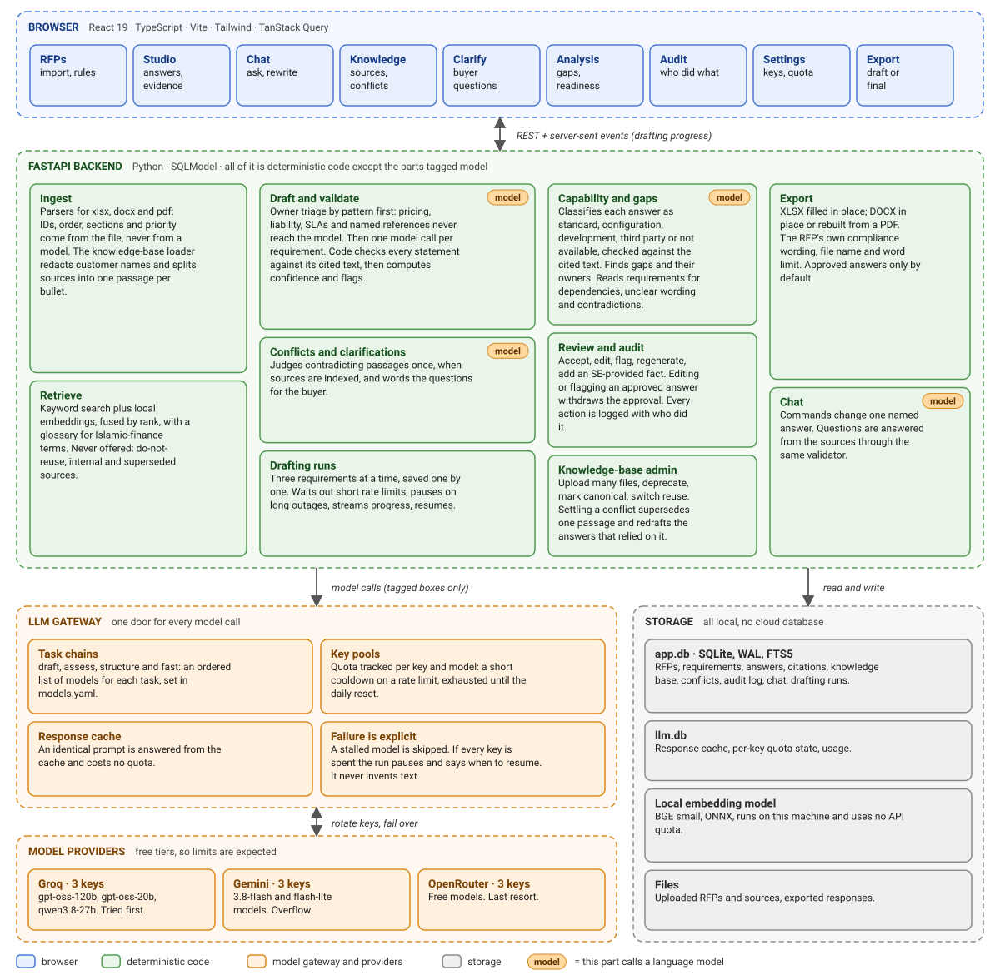
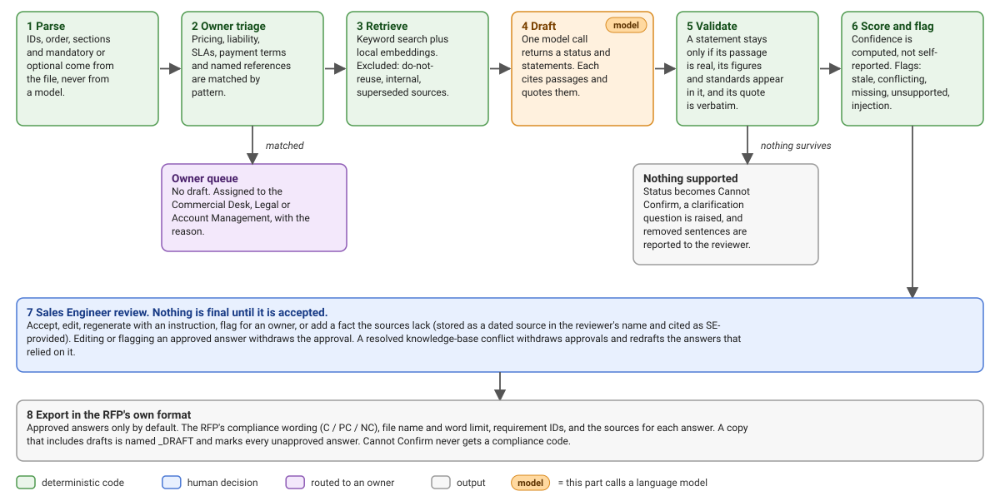
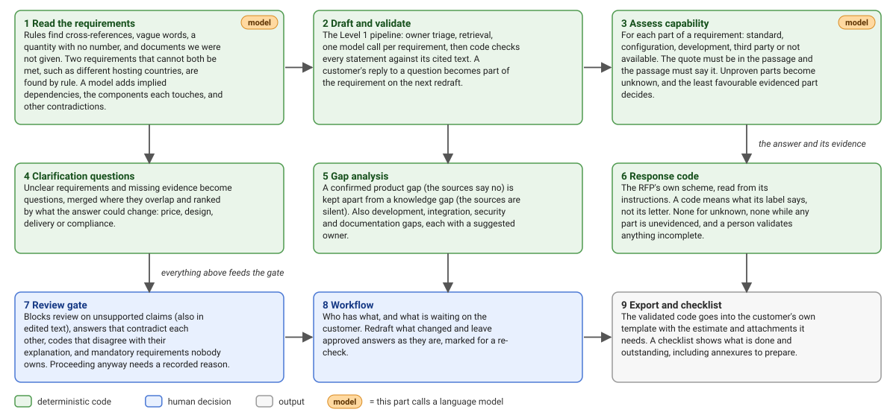

# RFP AI: architecture note

A Sales Engineer uploads an Islamic banking or lending RFP. RFP AI drafts each answer **only from approved sources**,
cites every statement, flags missing, conflicting and stale evidence, routes pricing and legal questions to their
owners, and exports the response in the RFP's own format. The Sales Engineer (SE) approves every answer. Nothing is
final until they do.

All product content in the demo is **synthetic and labelled SAMPLE** (a fictional product, "Meridian Islamic Banking
Suite"). No real customer or Azentio data is used.

## 1. Components and data flow

Green boxes are deterministic code. The orange `model` tag marks the only places a language model is called: drafting, the contradiction judge, clarification wording and chat answers. Everything else, including every check on what a model writes, is code. A PNG copy for slides is in `docs/architecture.png`.

### Data model

| Table | Holds |
|---|---|
| `Rfp`, `Section`, `Requirement` | the imported RFP: its ID, order, section, mandatory or optional, where to write the answer back, the parse report, the detected format rules (including the response codes) and deadline, which manual checklist items are ticked, and for each requirement what reading it found: dependencies, components, unclear wording |
| `KbDocument` | a source: kind, date, product version, `approved` or `deprecated`, `canonical`, `reuse_permitted`, `answerable`, customer, and `display_title` (the customer-redacted title, the only one ever shown or cited) |
| `KbChunk` | one searchable passage: text, location (section or page), embedding. Each has a row in the FTS5 index |
| `Answer` | one per requirement: draft text, the SE's edited text, status, computed confidence and its breakdown, triage route, flags and their details, review status (`queued`, `drafted`, `accepted`), assignee |
| `Citation` | one per cited passage: the verbatim quote, document title, date and location |
| `ClarificationQuery` | a question for the buyer, with its reason, the requirement IDs it covers, a priority and what it could change (design, delivery, commercial, compliance), what raised it, who owns it, and the customer's reply |
| `Assessment` | one per requirement, apart from `Answer` so the answer logic is untouched: the capability class and the evidenced parts behind it, the suggested response code, what the code needs, whether a person has validated it, the gaps with their owners, and a fingerprint of the answer it was built from |
| `Conflict` | two contradicting passages, the topic, `open` or `resolved`, and the canonical document once an SME decides |
| `AuditEvent` | who did what and when: drafts, edits, approvals, flags, regenerations, SE facts, KB changes, conflict resolutions, exports |
| `ChatMessage`, `Job` | the conversation for an RFP; a drafting run (per-requirement state lives on `Answer`) |

The LLM gateway keeps its own file, `llm.db`: the response cache, per-key and per-model quota state, and usage.
There are no schema migrations. At startup the backend checks the database file against these tables and refuses an
outdated one with a clear message, instead of failing later with a server error.

## 2. One requirement, end to end

A PNG copy is in `docs/pipeline.png`. The steps in words:

1. **Import.** A deterministic parser reads the file. Requirement IDs, section membership, order and
   mandatory/optional come from the document, never from a model. Where to write the answer back is recorded.
2. **Owner triage.** Pricing, liability, indemnity, SLAs and service credits, payment terms and named customer
   references are matched by pattern and **never reach the model**. They go to an owner.
3. **Retrieve.** Keyword search (SQLite FTS5 BM25, expanded with an Islamic-finance glossary) is fused with local
   embeddings by reciprocal rank. Two filters cannot be switched off: sources that must not be reused, and sources
   that must not be used for answers. A passage an SME has superseded is never offered. Every passage carries its
   source, location, date and freshness.
4. **Draft.** One model call per requirement returns a status and a list of statements, each with the passage numbers
   that support it and a verbatim quote. Text inside the requirement that addresses an AI is removed first and reported.
5. **Validate. This is where "no invented facts" is enforced, in code.** A statement survives only if it names a real
   passage, states only numbers, dates and standards that its cited text states, and overlaps that text. A requirement
   that names a certification no source mentions (ISO 22301) can never be "Complied". A status with no surviving
   supported statement becomes "Cannot Confirm". A status that contradicts the answer's own words is corrected.
6. **Flag.** `stale` (source too old or for an old product version), `conflicting` (a cited passage contradicts
   another, found at index time), `missing`, `unsupported`, `injection`, `se_provided`.
7. **Score.** Confidence is computed from retrieval coverage, claim support and freshness, with penalties. It is shown
   with its breakdown. It is not self-reported and not calibrated against outcomes.
8. **Review.** The SE accepts, edits, regenerates, flags to an owner, or supplies a fact the sources lack (stored as a
   dated, authored source and cited as SE-provided). Editing or re-statusing an accepted answer withdraws the approval.
9. **Export.** Approved answers only by default, in the RFP's own format, with its compliance wording, file name and
   per-answer source references. A review copy that includes drafts is named `_DRAFT`, marks every unapproved answer,
   and carries a banner.

### Around the pipeline

- **Knowledge base administration.** Sources are added in the UI, one or many files at once (Word, PDF, Markdown or
  text, up to 15 MB each), each with its own date, version, kind and customer. They are sent one after another and
  each reports its own result. An SME can deprecate a source, mark it canonical, or switch off reuse or use for
  answers. These take effect on the next retrieval and are audited. A source that answers cite cannot be deleted,
  only deprecated, so those answers keep their evidence.
- **Settling a conflict.** The SME picks the document that is right. The other side's passage is marked superseded:
  it stays in the knowledge base for the audit trail but is never offered to the model again. Approvals on the
  answers that cited either side, or were flagged because of the conflict, are withdrawn, because the evidence
  changed, and those answers are redrafted.
  If a drafting run is already going, the redraft joins it.
- **Drafting runs.** Each requirement is saved as soon as it is done, three at a time, with progress streamed to the
  browser and a polling fallback. One failing requirement does not stop the others. A rate limit shorter than
  about 2.5 minutes is waited out automatically. A longer outage pauses the run, says when to resume, and keeps
  everything already drafted. Closing the browser or restarting the backend loses nothing.
- **Chat.** A message that matches an explicit command to change something (accept, rewrite, add a fact) acts only
  on a requirement it names or that is selected, and refuses when there is nothing to act on. Summaries, lists and
  "why was 3.4 flagged?" only read. Any other message is a question,
  answered through the same prompt and validator as a draft, with its sources. History is stored and restored.
- **Format rules.** Word limit, compliance wording, required file name and both deadlines are read from the RFP's
  instructions by pattern, not by a model, and shown at import for the SE to confirm at export. Compliance wording
  is recognised as `using only: C = ..., PC = ...` and as `C (Complies), PC (...) or NC (...)`. A rule that is not
  stated is reported as not stated, never guessed.

## 3. Models and tools

| Purpose | Choice | Notes |
|---|---|---|
| Drafting | Groq `gpt-oss-120b`, then Gemini `3.8-flash`, then Groq `qwen3.8-27b` | Groq first: fast and dependable on the day it was measured |
| Capability assessment | Groq `gpt-oss-120b`, `qwen3.8-27b`, then Gemini `3.8-flash` | Same chain as drafting with the two Groq models first, because Gemini stalled on the probe day |
| Reading the requirements (`structure`) | the draft chain | One call per 30 requirements, so cost is small |
| Quick calls (conflict judge, clarification wording) | Groq `gpt-oss-20b`, `qwen3.8-27b`, then Gemini flash-lite | |
| Last resort | OpenRouter free models | Slow and capped per account; resilience, not capacity |
| Embeddings | `BAAI/bge-small-en-v1.5` via fastembed (local ONNX) | Costs no quota. If absent, search falls back to keyword only and says so |
| Search | SQLite FTS5 (BM25) + cosine over stored vectors, rank fusion | |
| Parsing | openpyxl, python-docx, pdfplumber | Scanned PDFs are not supported (no OCR) |
| Backend | FastAPI, SQLModel, SQLite (WAL) | |
| Frontend | React 19, TypeScript, Vite, Tailwind 4, TanStack Query | |

Model IDs are in `models.yaml` and were verified with real calls on 2026-10-31. Free-tier availability changes fast:
`scripts/list_models.py --probe` re-checks them.

### Level 2: from requirements to a submission-ready response

A PNG copy is in `docs/level2.png`. The same rule runs through all of it: **a model proposes, code decides what stands,
and a person validates whatever the evidence leaves incomplete.**

- **Response codes are read from the RFP, never assumed.** The instructions are scanned for the codes the buyer asks for
  (`S = Standard, C = Configuration, D = Development, T = Third party, N = Not available`, a plain word list, or a table).
  A code means what its label says, not what its letter suggests, so `Y = Standard` works. A label that cannot be placed
  stays unmapped for the Sales Engineer. Which codes need an explanation, an estimate or an attachment is read from the
  sentences that say so. The scheme is shown in the export dialog for the SE to correct.
- **Capability is classified part by part.** For each distinct thing a requirement asks for, the model proposes standard,
  configuration, development, third party or not available. Code then checks every part: its quote must be in a cited
  passage, and that passage must actually say it (a "not available" needs a passage that says so, or says the thing must be
  done manually; a "configuration" needs a passage about configuring). A part that fails is downgraded to *unknown*. The
  least favourable evidenced part decides the class. Nothing is ever coded *unknown*, nothing is coded while any part is
  unevidenced, and a "Cannot Confirm" answer never gets a code.
- **A confirmed gap is not a knowledge gap.** "The sources say the product does not do this" is a confirmed product gap for
  Product Management. "The sources are silent" is a knowledge gap for whoever can find out. Development, integration,
  security and documentation gaps are kept apart too, each with a suggested owner.
- **The explanation must agree with its code.** If the answer mentions a partner but the class is standard, or says
  Complied while the evidence says not available, that is flagged, and it blocks review until a person decides.
- **Requirements are read, not just answered.** Rules find explicit cross-references (`as in requirement 1.2`), vague words
  (`adequate`, `as required`), a quantity with no figure, and documents that are referred to but not supplied (`Annexure B`).
  A model adds implied dependencies, the components each requirement touches, and contradictions; anything it reports must
  quote the requirement's own words or it is dropped. Two requirements that cannot both be met, such as different hosting
  countries or different RTO figures, are also found by rule, because a check that only sometimes fires is not a check.
- **Clarification questions are ranked and merged.** Missing evidence and unclear requirements become questions, merged
  where they overlap (two requirements that contradict each other raise one), and ranked high, medium or low by rule from
  how mandatory it is, how many requirements it settles, and whether it touches price, design, delivery or compliance. The
  model only words the question. A customer's reply becomes part of the requirement on the next redraft.
- **The review gate stops what a reviewer should not have to find.** Unsupported claims in the current text (including text
  a person edited after drafting), answers that contradict each other, mismatched codes, and mandatory requirements nobody
  owns are blockers. Proceeding anyway needs a written reason, which is recorded. Everything else is a warning.
- **Workflow tracks who has what.** Each requirement is in one state (not drafted, waiting for the customer, with an owner,
  needs review, ready, approved), with suggested owners one click away. *Redraft what changed* rewrites what a customer reply
  or a dependency affected and **never touches an approved answer**: it marks it for a re-check, and approving it again
  clears the mark.
- **Export fills the customer's own template.** The validated code goes into their code column, with the estimate and
  attachments in the comments. An unvalidated suggestion is never written into the file as if it were settled. Extra sheets
  carry the matrix, the gap analysis, the ranked questions and a submission checklist that includes the annexures the
  instructions asked for.

### Design choices and why

**Why these models.** The constraint was free tiers with daily limits, so the choice was driven by what a free key
can actually deliver, probed with real calls on 31 October 2026:

| Model | Used for | Why |
|---|---|---|
| Groq `gpt-oss-120b` | drafting (first choice) | The largest of the three Groq models we use. Answered in 0.2 to 0.8 s on probes, accepted native JSON output, and all three keys worked |
| Groq `qwen3.8-27b` | drafting (third, after Gemini), quick tasks (second) | A separate quota from the 120b, so when one is rate-limited the other keeps going |
| Groq `gpt-oss-20b` | contradiction judge, clarification wording | Short, simple tasks: about 480 prompt tokens, answered in 0.8 s |
| Gemini `3.8-flash`, flash-lite | overflow | Long context, but erratic that day: 503 "high demand" on two keys and stalls past 60 s. So it is overflow, not first choice |
| OpenRouter free models | last resort | Slow, and one limit covers the whole free account. They add resilience, not capacity |
| `BAAI/bge-small-en-v1.5` | embeddings | Small, strong English retriever that runs on the CPU with no API quota. 384 dimensions |

Settings: temperature 0, JSON output validated against a schema with one repair retry, up to 2,000 tokens out for a draft.
Quota is tracked per key and model, so each extra Groq or Gemini model adds an independent budget.

We did **not** benchmark the models against each other on accuracy. We chose on availability, speed and reliable
JSON, then measured the whole system (section 6). That is sound here because correctness does not rest on the model
alone: the validator removes what the sources don't support. A weaker model costs completeness (more "Cannot
Confirm"), not invented facts.

**Chunking.** Structure first, then size.

- Sources are split on their own headings: Markdown `##`, Word heading styles, and bold lines in a PDF. Each
  chunk keeps its heading and a location (section, plus page for a PDF) so a citation can point to it.
- A short section stays whole. A longer one is split on sentence boundaries into pieces of at most 900
  characters, with one sentence of overlap.
- A list of two or more items becomes one chunk per item, so a conflict or stale flag on one item cannot taint an
  answer that cites a different item. Testing showed this: before it, whole-list chunks produced false conflicts.
- Customer names are redacted before anything is stored. Text in a source must be able to become evidence, whatever shape
  the file is in:
  - **Word tables** are read in place, under the heading they sit beneath, one fact per row. With a header row a row reads
    "Region: UAE; Status: Live", so it makes sense when quoted on its own. Merged cells are not repeated.
  - **Word files with no heading styles** treat a short bold paragraph as a heading; if there is none, the text is indexed whole
    under the document's title. In a file that does use heading styles, bold is just emphasis.
  - **Text before the first heading** is kept, under the title. Stamps and the date line are not, so test boilerplate never
    becomes a passage (the previous reader indexed one such stamp in two PDFs).
  - **PDFs with no bold text** are indexed page by page, so a citation still names its page.
  - A file with no text at all (a scanned PDF) yields nothing, and the upload says so.
- Passage size matters for the brief's central rule: a quote should be a complete statement, not a fragment.

**Retrieval.** Hybrid, local, and filtered before ranking.

1. Query terms: the requirement's own content words (up to 24) plus up to 12 synonyms from a glossary of 21
   Islamic-finance terms (Murabaha, Ijara, Tawarruq, Takaful and so on).
2. Two searches, each returning its top 30: keyword (SQLite FTS5, BM25, with the document title indexed with each
   chunk) and cosine similarity over local embeddings.
3. Merged by reciprocal rank fusion (constant 60). It needs no score calibration between two very different scales.
4. The top 6 passages go to the model, at about 1,800 prompt tokens in all.
5. Filters applied in the query itself, so they cannot be skipped: not reusable, not for answers, superseded. Stale
   sources are kept and flagged, because a stale passage is how a contradiction is noticed.

Why hybrid: keyword search is exact on `ISO 27001` or `AES-256`; embeddings catch paraphrase ("outside engineers"
against "vendor staff"). Measured: all 58 requirement-to-source checks found in the top 6 by both; on 12
paraphrased queries hybrid found 12 and keyword 11; on 10 held-out queries written before the glossary was extended,
hybrid found 10 and keyword 9. No vector database: a few thousand passages need only SQLite and a matrix multiply.

**How many agents.** One. This is a pipeline of eight steps, not a multi-agent system. Four of the places in it can
call a model: the drafter, the contradiction judge, the clarification writer and the chat answerer. No model plans,
picks tools, decides what to retrieve or loops on its own. That is deliberate:

- every guardrail has to be code to be auditable, and a model that steers the process is a model that can be
  steered by text inside an RFP;
- each extra call spends free-tier quota;
- a fixed order makes every answer reproducible and explainable.

Three requirements are drafted at the same time. In the held-out test, each draft call averaged about 1,800 prompt
and 500 output tokens and took 1.6 s, and 23 requirements took about two minutes end to end.

**How confidence is computed.** `0.30 x retrieval + 0.45 x support + 0.25 x freshness`, where retrieval blends how
well the cited text covers the requirement with embedding similarity, support is the share of quoted claims and
sentences that check out, and freshness is 1.0, or 0.4 if a source is stale. Then multipliers: 0.75 for conflicting
sources, 0.85 for removed statements, 0.85 for missing evidence, 0.8 for instructions found in the requirement;
"Cannot Confirm" is halved and capped at 0.35. It is shown with its breakdown and is not calibrated against outcomes.

## 4. The LLM gateway and free-tier limits

Each task (`draft`, `assess`, `structure` and `fast`) has an ordered chain of models. Quota is tracked per **(key, model)**:

| Event | Behaviour |
|---|---|
| Per-minute rate limit (429) | that key and model cool down; the next key is tried, then the next model |
| Per-day limit | marked exhausted until the provider's reset time |
| Fast 5xx (503, "high demand") | 30 s cooldown for that key and model |
| Timeout | the whole model is skipped on every key for 2 minutes (a stall is model-wide) |
| Every attempt failed (bad output, rejected) | reported as a failure, never as a quota pause |
| All keys rate-limited | the job waits out a short limit by itself, or pauses and says when to resume |

Identical prompts are served from a cache at no quota cost. Measured on the Groq free tier: 8,000 tokens per minute
and 1,000 requests per day per key and model, so a full RFP needs spreading across keys and models. Gemini was
erratic (503s and stalls) and the OpenRouter accounts are free tier. Keys live only in the backend `.env`; the UI shows
aliases such as `groq#2`.

## 5. How this meets the brief's guardrails

| Brief | Where it is enforced |
|---|---|
| SE in control: nothing final until approved | review state machine; export defaults to approved only; edits and hand-offs withdraw approval |
| Pricing, SLA, liability, commitments never auto-answered | pattern triage before any model call; owner routing; "Cannot Confirm" gets no compliance code |
| Confidentiality: reuse only where permitted, names redacted | `reuse_permitted` filter in retrieval (cannot be switched off); redaction at index time, so prompts, quotes and exports only ever see redacted text |
| Source quality: surface outdated sources | rule-based staleness (age, product version, deprecated) on every cited source |
| Agents show reasoning or cite sources | verbatim quotes with location and date; "why this status"; confidence breakdown; audit trail |
| No invention | the validator described in section 2, step 5 |
| Prompt injection in an RFP | bracketed instructions removed before drafting and reported; the prompt marks all document text as untrusted |

## 6. Evidence

| Check | Result |
|---|---|
| Backend tests (offline, no keys) | 489 passing: parsers, retrieval, validator, gateway failover, review, export, chat |
| Live evaluation, 74 sample requirements, 3 formats | 73/74 as scored; 74/74 after correcting one over-literal check; **72/74 against the original stricter key** |
| Independent audit of saved answers (verbatim quotes, every sentence cited, no names, no forbidden source) | 0 failures in the last two runs. It caught a real validator bug in run 1 |
| Real-browser end-to-end (Chrome via Playwright) | 31/31 steps, including WCAG AA contrast in light and dark and a phone-width layout. Re-run after the latest changes |
| Held-out live test (`live_test/`): a different product, 11 sources, 23 requirements | all 23 statuses in the expected range; 0 guardrail failures; 57 of 57 saved citation quotes verbatim; no restricted or internal source cited; no customer name or internal figure in any answer, chat reply or export |
| Retrieval, 58 requirement-to-source checks | 100% in the top 6, keyword and hybrid |
| Retrieval on 10 fresh paraphrases | keyword 9/10, hybrid 10/10 |

| Level 2 live test (`live_test/GUIDE_LEVEL2.md`): an RFP asking for S / C / D / T / N codes, 18 requirements | capability as expected on 17 of 17 assessed requirements and all 10 planted gaps found. The first run scored 14 of 16 and 7 of 10 |
| Level 2 browser check, 12 steps with every field typed key by key | 12 of 12, no failed requests, no console errors |

**What the Level 2 live run found.** Running the real models on the Level 2 RFP exposed weaknesses no unit test had:

1. The "standard" check wanted verbs like *supports* and rejected "charges are **posted** to a charity account". It now
   accepts any affirmative statement that is not negated and does not describe an extension.
2. "The rebate **must be approved manually**" is evidence that automatic application is not provided, but the check wanted
   the word "not". Manual-only phrasings now count.
3. A requirement with one evidenced part and one unevidenced part was given the optimistic code **S**. No code is suggested
   while any part is unevidenced.
4. "Integrate as described in Annexure B" retrieved a passage about adapters and was given code **C**, although the answer was
   Cannot Confirm. A Cannot Confirm answer now never gets a code.
5. The model noticed a planted contradiction (hosting in Qatar against the UAE) in one run and missed it in another, so the
   common families are now found by rule.

Fixes 1 to 4 were made after seeing the first run's results, so the final score is not an independent test: the Level 2
set was written by the same hand as its expectations, and its model outputs were partly replayed from a cache when scoring.

**Defects found after the main evaluation.** Running new material through the app found three that the earlier
checks missed, and each is fixed with a test:

1. The held-out RFP words its compliance codes as `C (Complies), PC (...) or NC (...)`. The detector only knew one
   phrasing, so the exported Compliance column came out empty.
2. The flag and add-fact dialogs lost focus after every keystroke, so only the first character stayed. The browser
   check missed it because it filled fields in one step; it now types key by key.
3. A database file from an early version made every knowledge-base request return a server error. Startup now
   refuses such a file with a clear message.

The first of these means the live-test RFP is no longer a fully unseen test.

**What this does not prove.** One sample of a non-deterministic model: the same requirement flipped between
Complied and Partially Complied across runs. The data was written by the same hand as the expected answers.
Six expectations were relaxed after run 2 where a careful model was right and the key was too strict (each is annotated
in `scripts/sample_rfps.py`). Confidence is uncalibrated. No real RFP has been tried. Exported files were verified by
re-reading them with openpyxl and python-docx, not by opening them in Excel or Word. The live-test documents and
their expectations were also written by the same hand, and its results come from one run through the API.

## 7. Moving to production

| Today | For production |
|---|---|
| Single user, no login; reviewer name is typed | SSO, roles (SE, SME, owner, admin), per-RFP access |
| SQLite and local files, no migrations | Postgres with pgvector, object storage for uploads and exports, and real migrations |
| Drafting runs in the API process | a worker queue (jobs are already per-requirement and resumable) |
| Free-tier keys rotated by the gateway | paid keys with budgets, plus spend and latency monitoring |
| `.env` for keys | a secrets manager |
| Local embedding model | a hosted embedding service or a pinned model server |
| Level 2 checks, owners and states live in the same single-user database | roles and per-RFP access decide who may validate a code or override the gate |
| Evaluation run by hand | the golden evaluation and browser check in CI, with a fixed model version |
| No OCR | an OCR step for scanned RFPs |
| English RFPs only | Arabic RFP and answer support |

## 8. Known limits

- Scanned PDFs are rejected with a clear message. Unusual spreadsheet layouts may need the parse report corrected.
- A PDF RFP is answered in Word (as the sample RFP asked), not as a PDF.
- The chat changes an answer only through explicit commands that name a requirement. Free-form messages are questions.
- Conflict detection compares passages that share a kind of fact; it can miss a contradiction phrased very differently.
- Annexures are not a separate concept: upload them as another RFP, or add them to the knowledge base.
- There are no general schema migrations. New columns are added to an existing database automatically; anything else
  needs the file deleted and recreated, and the backend says so at startup.
- Capability checks use word lists to decide whether a passage "says" something. They are deliberately strict, so they
  err towards "unknown" and a person validating. Two real phrasings were missed on the first live run and fixed; others will
  exist. Wording they do not know yields *unknown*, never a wrong code.
- Contradictions between requirements are found by rule for two families (a required location, a required figure) and by a
  model for the rest, and a model's notice of them varies between runs. A rule can be wrong about scope: two figures may
  legitimately apply to different services. A person decides.
- Model-found ambiguity is the noisiest part: it sometimes questions wording that is clear to a bank (it asked what
  "charity" meant). Questions need a person's approval before they go to the customer.
- Estimates and attachments go into the comments column, not into dedicated columns of the customer's template. Level 2
  export was tested on Excel; a Word RFP gets the code, the gap table and the checklist as appended tables and paragraphs.
- Several knowledge-base files can be added at once, but an RFP is imported one file at a time.
- The simulated connector cards in the original mockup (Confluence, Notion, Drive, Jira) were not built.
